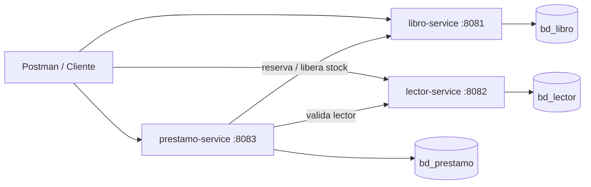

# Laboratorio 03 - Sistema de biblioteca con microservicios

**Estudiante:** Sofía Cindell Carita Quispe  
**Curso / Evaluación:** DESARROLLO DE APLICACIONES WEB AVANZADO: Microservicios  
**Sección:** 4 - C24 - Sección A - B  
**Laboratorio:** 03 - Sistema de biblioteca  
**Tema:** Microservicios con Spring Boot, Spring Data JPA, MySQL, API REST, DTO, validaciones y pruebas en Postman

## 1. Descripción

Solución individual para la administración de una biblioteca mediante tres microservicios independientes:

- `libro-service`: catálogo de libros, ISBN, autor, stock y estado.
- `lector-service`: registro de lectores con documento, nombres y contacto.
- `prestamo-service`: préstamos y devoluciones; referencia libros y lectores por ID.

Cada microservicio tiene su propia base de datos y puerto. No se comparten tablas directamente entre servicios; la comunicación entre `prestamo-service` y los otros servicios se hace por API REST.

## 2. Arquitectura y bases de datos

| Microservicio | Puerto | Base de datos | Responsabilidad |
|---|---:|---|---|
| `libro-service` | 8081 | `bd_libro` | CRUD de libros, validación de ISBN único, control de stock y estado. |
| `lector-service` | 8082 | `bd_lector` | CRUD de lectores, documento único y datos de contacto. |
| `prestamo-service` | 8083 | `bd_prestamo` | Registro de préstamos, devolución, actualización de fecha límite y consulta por filtros. |

Diagrama:

- [Versión Mermaid](docs/diagrama-microservicios.md)
- [Versión SVG](docs/diagrama-microservicios.svg)



## 3. Tecnologías

- Java 17+
- Spring Boot 3.3.5
- Spring Web, Spring Data JPA, Spring Validation, Spring DevTools
- MySQL 8+
- Maven 3.9+
- Postman para pruebas

## 4. Estructura del proyecto

```text
Lab03-Biblioteca-Microservicios/
├── pom.xml                         # Agregador Maven de los 3 servicios
├── libro-service/                  # Microservicio de libros
├── lector-service/                 # Microservicio de lectores
├── prestamo-service/               # Microservicio de préstamos
├── scripts/
│   └── 01-create-databases.sql     # Creación de BD y tablas
├── postman/
│   ├── Lab03-Biblioteca.postman_collection.json
│   └── Lab03-Biblioteca-Local.postman_environment.json
├── docs/
│   ├── diagrama-microservicios.md
│   ├── diagrama-microservicios.svg
│   └── conclusiones-sustentacion.md
└── README.md
```

Cada servicio organiza el código en paquetes `model`, `dto`, `repository`, `service`, `controller` y `exception`. `prestamo-service` agrega `client` para comunicarse con los otros microservicios.

## 5. Requisitos previos

1. Instalar JDK 17 o superior y agregarlo al `PATH`.
2. Instalar Maven 3.9+.
3. Instalar MySQL Server 8+ y iniciar el servicio.
4. Opcional: Postman para importar la colección de pruebas.
5. No subir credenciales reales a repositorios públicos. Los valores por defecto son solo para entorno local de laboratorio.

Verificar instalación:

```powershell
java -version
mvn -version
mysql --version
```

## 6. Configurar bases de datos

Desde MySQL Workbench, la consola de MySQL o el cliente `mysql`, ejecutar:

```powershell
mysql -u root -p < scripts\01-create-databases.sql
```

El script crea:

- `bd_libro` y la tabla `libros`.
- `bd_lector` y la tabla `lectores`.
- `bd_prestamo` y la tabla `prestamos`.

En perfiles `dev`, Hibernate usa `ddl-auto: update` para facilitar el trabajo de laboratorio. En perfiles `prod`, usa `ddl-auto: validate` para no alterar automáticamente el esquema.

## 7. Variables de entorno y perfiles dev/prod

El perfil activo se controla con `SPRING_PROFILES_ACTIVE`. Si no se define, se usa `dev`.

| Variable | dev | prod | Uso |
|---|---|---|---|
| `SPRING_PROFILES_ACTIVE` | `dev` por defecto | Debe definirse como `prod` | Selecciona configuración. |
| `DB_URL` | Valor local por defecto | Obligatoria, sin valor por defecto | JDBC URL de la BD de cada servicio. |
| `DB_USERNAME` | `root` por defecto | Obligatoria | Usuario MySQL. |
| `DB_PASSWORD` | `root` por defecto | Obligatoria | Contraseña MySQL. |
| `SERVER_PORT` | 8081/8082/8083 | Configurable | Puerto del servicio. |
| `LIBRO_SERVICE_URL` | `http://localhost:8081` | Obligatoria | URL usada por `prestamo-service`. |
| `LECTOR_SERVICE_URL` | `http://localhost:8082` | Obligatoria | URL usada por `prestamo-service`. |

Ejemplo para producción:

```powershell
$env:SPRING_PROFILES_ACTIVE="prod"
$env:DB_URL="jdbc:mysql://mysql-prod.example.com:3306/bd_libro?useSSL=true&serverTimezone=America/Lima"
$env:DB_USERNAME="usuario_app"
$env:DB_PASSWORD="clave_segura"
$env:SERVER_PORT="8081"
mvn -pl libro-service spring-boot:run
```

Diferencias principales entre ambientes:

- `dev`: SQL visible en consola, `ddl-auto: update`, credenciales locales por defecto, logs de Hibernate.
- `prod`: sin SQL en consola, `ddl-auto: validate`, sin credenciales por defecto, logs generales.

## 8. Compilar y ejecutar

### 8.1 Compilar todo

Desde la raíz del proyecto:

```powershell
mvn clean package
```

### 8.2 Ejecutar cada servicio

Abrir tres terminales.

Terminal 1:

```powershell
mvn -pl libro-service spring-boot:run
```

Terminal 2:

```powershell
mvn -pl lector-service spring-boot:run
```

Terminal 3:

```powershell
mvn -pl prestamo-service spring-boot:run
```

Orden recomendado: iniciar primero `libro-service` y `lector-service`; luego `prestamo-service`.

Verificar que responden:

```powershell
curl.exe http://localhost:8081/api/libros
curl.exe http://localhost:8082/api/lectores
curl.exe http://localhost:8083/api/prestamos
```

## 9. Endpoints principales

### 9.1 Lector service — `http://localhost:8082`

| Método | Endpoint | Descripción |
|---|---|---|
| GET | `/api/lectores` | Lista lectores. |
| GET | `/api/lectores/{id}` | Obtiene lector por ID. |
| GET | `/api/lectores/documento/{documento}` | Busca lector por documento. |
| POST | `/api/lectores` | Crea lector. Requiere documento, nombres y contacto. |
| PUT | `/api/lectores/{id}` | Actualiza lector. |
| DELETE | `/api/lectores/{id}` | Elimina lector. Responde 204. |

Crear lector:

```json
{
  "documento": "12345678",
  "nombres": "Sofía Cindell Carita Quispe",
  "contacto": "sofia.carita@example.com"
}
```

### 9.2 Libro service — `http://localhost:8081`

| Método | Endpoint | Descripción |
|---|---|---|
| GET | `/api/libros` | Lista libros. |
| GET | `/api/libros/{id}` | Obtiene libro por ID. |
| POST | `/api/libros` | Crea libro. Requiere ISBN, título, autor, stock y estado. |
| PUT | `/api/libros/{id}` | Actualiza libro. |
| DELETE | `/api/libros/{id}` | Elimina libro. Responde 204. |
| POST | `/api/libros/{id}/reservar` | Operación interna: descuenta una unidad de stock. |
| POST | `/api/libros/{id}/liberar` | Operación interna: repone una unidad de stock. |

Crear libro:

```json
{
  "isbn": "978-612000001-0",
  "titulo": "Clean Code",
  "autor": "Robert C. Martin",
  "stock": 2,
  "estado": "DISPONIBLE"
}
```

Estados válidos de libro: `DISPONIBLE`, `NO_DISPONIBLE`, `MANTENIMIENTO`.

### 9.3 Prestamo service — `http://localhost:8083`

| Método | Endpoint | Descripción |
|---|---|---|
| GET | `/api/prestamos` | Lista préstamos. Acepta filtros opcionales `lectorId`, `libroId`, `estado`. |
| GET | `/api/prestamos/{id}` | Obtiene préstamo por ID. |
| POST | `/api/prestamos` | Registra préstamo. Valida lector, libro y stock. |
| PUT | `/api/prestamos/{id}` | Modifica fecha límite de un préstamo ACTIVO. |
| PUT | `/api/prestamos/{id}/devolucion` | Marca préstamo como DEVUELTO y repone stock. |
| DELETE | `/api/prestamos/{id}` | Elimina préstamo. Si está ACTIVO, repone stock antes de eliminar. |

Crear préstamo:

```json
{
  "lectorId": 1,
  "libroId": 1,
  "fechaPrestamo": "2026-11-04",
  "fechaLimite": "2026-11-18"
}
```

Actualizar fecha límite:

```json
{
  "fechaLimite": "2026-11-25"
}
```

Estados válidos de préstamo: `ACTIVO`, `DEVUELTO`, `CANCELADO`.

Ejemplos con filtros:

```text
/api/prestamos?estado=ACTIVO
/api/prestamos?lectorId=1
/api/prestamos?libroId=1&estado=DEVUELTO
```

## 10. Manejo de errores y DTO

Los errores se devuelven en JSON con estructura uniforme:

```json
{
  "timestamp": "2026-11-04T10:30:00.123",
  "status": 400,
  "error": "Bad Request",
  "message": "La información enviada no es válida",
  "path": "/api/libros",
  "details": {
    "stock": "El stock no puede ser negativo"
  }
}
```

Casos cubiertos:

- `400 Bad Request`: JSON mal formado, campos obligatorios ausentes, formatos inválidos, stock negativo, fecha límite anterior al préstamo.
- `404 Not Found`: libro, lector o préstamo inexistente.
- `409 Conflict`: ISBN o documento duplicado, stock insuficiente, libro no disponible, préstamo ya devuelto.
- `503 Service Unavailable`: `prestamo-service` no puede comunicarse con `libro-service` o `lector-service`.

## 11. Flujo de préstamo y devolución

1. Cliente crea lector en `lector-service`.
2. Cliente crea libro en `libro-service` con `stock >= 1` y estado `DISPONIBLE`.
3. Cliente registra préstamo en `prestamo-service`.
4. `prestamo-service` valida que el lector exista en `lector-service`.
5. `prestamo-service` solicita a `libro-service` reservar stock.
6. `libro-service` bloquea el registro, descuenta stock y cambia a `NO_DISPONIBLE` si llega a cero.
7. `prestamo-service` guarda el préstamo como `ACTIVO`.
8. Al devolver, `prestamo-service` cambia el estado a `DEVUELTO`, registra `fechaDevolucion` y solicita reponer stock.

Si falla el guardado del préstamo después de reservar stock, `prestamo-service` ejecuta una compensación para liberar el stock. Esto no reemplaza una transacción distribuida, pero es suficiente para el alcance del laboratorio.

## 12. Pruebas con Postman

Importar en Postman:

1. `postman/Lab03-Biblioteca-Local.postman_environment.json`
2. `postman/Lab03-Biblioteca.postman_collection.json`
3. Seleccionar el entorno **Lab03 Biblioteca - Local**.
4. Ejecutar las carpetas en orden: `Lector`, `Libro`, `Prestamo y devolucion`.

La colección incluye casos exitosos y fallidos:

- Crear/listar/obtener/actualizar/eliminar lector y libro.
- Errores de validación: documento inválido, stock negativo, fecha límite anterior al préstamo.
- Recursos inexistentes: lector y libro con ID `999999`.
- Conflicto por ISBN duplicado y devolución duplicada.
- Préstamo y devolución end-to-end.

La colección guarda automáticamente `lectorId`, `libroId` y `prestamoId` en variables de colección mediante scripts de prueba.

## 13. Prueba de aceptación específica

La prueba solicitada por la guía es préstamo y devolución, incluyendo casos válidos e inválidos.

### Caso válido

1. Crear lector con documento `12345678`.
2. Crear libro `978-612000001-0` con stock `2`.
3. Crear préstamo con `lectorId` y `libroId` generados.
4. Verificar respuesta `201 Created` y estado `ACTIVO`.
5. Consultar `GET /api/libros/{id}` y comprobar stock descontado.
6. Ejecutar `PUT /api/prestamos/{id}/devolucion`.
7. Verificar respuesta `200 OK`, estado `DEVUELTO` y `fechaDevolucion` informada.
8. Consultar `GET /api/libros/{id}` y comprobar stock repuesto.

### Caso inválido

- Crear préstamo con `lectorId=999999`: responde `404 Not Found`.
- Crear préstamo con `libroId=999999`: responde `404 Not Found`.
- Crear préstamo con `fechaLimite` anterior a `fechaPrestamo`: responde `400 Bad Request`.
- Devolver dos veces el mismo préstamo: la segunda respuesta es `409 Conflict`.
- Crear libro con stock negativo: responde `400 Bad Request` con detalle de campo.

## 14. Evidencias para entregar

- Código fuente en este repositorio.
- Script SQL: `scripts/01-create-databases.sql`.
- Colección Postman: `postman/Lab03-Biblioteca.postman_collection.json`.
- Diagrama: `docs/diagrama-microservicios.svg` y `docs/diagrama-microservicios.md`.
- README completo de ejecución: este archivo.
- Conclusiones y preparación de sustentación: `docs/conclusiones-sustentacion.md`.

## 15. Checklist de la guía

- [x] Java y Spring Boot; proyectos Maven.
- [x] Spring Web, Spring Data JPA, MySQL Driver y DevTools.
- [x] Paquetes `model`, `dto`, `repository`, `service`, `controller` y `exception`.
- [x] Un microservicio por responsabilidad: Libro, Lector y Prestamo.
- [x] Base de datos propia por servicio.
- [x] Exposición de endpoints REST y colección Postman.
- [x] DTO y validaciones en operaciones de entrada.
- [x] Errores comprensibles y respuestas HTTP apropiadas.
- [x] `application.yml` con perfiles `dev` y `prod`.
- [x] IDs como referencias entre servicios; sin tablas compartidas.
- [x] README con requisitos, puertos, BD, ejecución y endpoints.
- [x] Script SQL de bases de datos.
- [x] Diagrama sencillo de microservicios y responsabilidades.
- [x] Cinco conclusiones técnicas y una dificultad con su solución.

## 16. Problemas frecuentes

### `Access denied for user 'root'@'localhost'`

Configurar credenciales con variables de entorno antes de ejecutar:

```powershell
$env:DB_USERNAME="root"
$env:DB_PASSWORD="tu_password_local"
```

### `Communications link failure`

MySQL no está iniciado o el puerto no es `3306`. Revisar servicio y URL JDBC.

### `Unknown database 'bd_libro'`

Ejecutar primero:

```powershell
mysql -u root -p < scripts\01-create-databases.sql
```

### `prestamo-service` responde 503

Significa que `libro-service` o `lector-service` no están iniciados, o las variables `LIBRO_SERVICE_URL` / `LECTOR_SERVICE_URL` apuntan a un puerto incorrecto.

### Puerto ocupado

Cambiar puerto de ese servicio:

```powershell
$env:SERVER_PORT="8091"
```

Y ajustar `LIBRO_SERVICE_URL` o `LECTOR_SERVICE_URL` en `prestamo-service` si corresponde.

## 17. Recomendaciones de seguridad

- No subir `application.yml` con contraseñas reales.
- Usar variables de entorno en producción.
- No mostrar contraseñas en capturas.
- En producción usar usuarios MySQL con permisos mínimos por base de datos.
- No usar `ddl-auto: update` en producción; usar `validate` y migraciones controladas.
